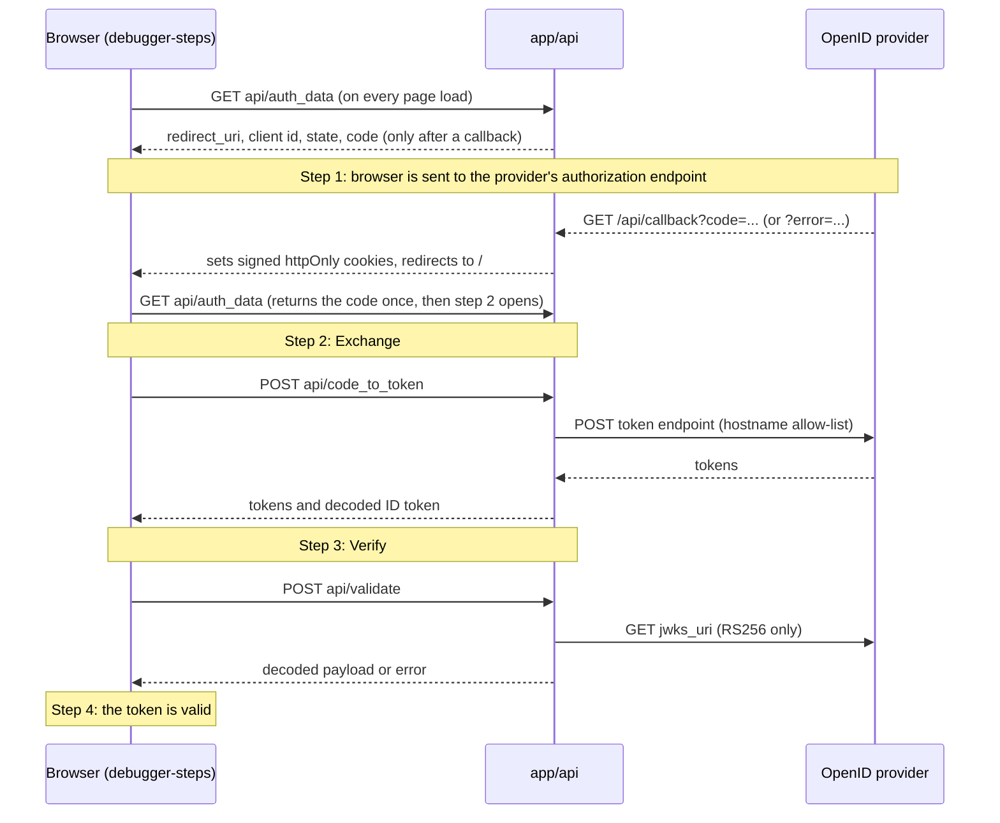

# Architecture guide

> Describes the shared shape of Auth0 developer microsites and how to document each one. Fill the "This project" blocks per repo.

## Stack profile

This repo uses the `nextjs-app` profile: Next.js (App Router), React and TypeScript, with API routes, unit tests in Vitest, E2E in Playwright and ESLint. The other kit profile (`static-eleventy`) does not apply here and is not used.

## Principles

1. **Server components by default**; add `"use client"` only where state or browser APIs are needed.
2. **Feature folders:** `src/features/<feature>/{components,services,models,actions}`; shared theme code in `src/libs/theme/`.
3. **Boundaries:** UI -> services -> pure functions. IO (network, storage, env, cookies) only at edges, such as `app/api/**` handlers and server actions.
4. **One pipeline.** Extend the existing Next build and Vercel deploy rather than adding a second.
5. **Generated output** (`.next/`) is git-ignored and never hand-edited. `public/bundle.js` is committed legacy output: ask first.

## Layout of this repo

```
app/                 routes, layout, app/api/* handlers
src/features/<f>/    components, services, models, actions
src/libs/theme/      fonts, globals.scss, _variables.scss, _mixins.scss
tests/               unit tests (Vitest, node environment)
e2e/                 Playwright (Chromium, Firefox)
public/              images, legacy bundle.js, cookie-consent.js
scripts/             oidc-install.mjs (Vercel install)
docs/ .agents/ AGENTS.md CLAUDE.md ENTRY_POINT.md
```

## This project

- **Profile:** `nextjs-app`. Next.js 16 (App Router), React 19, TypeScript strict, SCSS modules, react-select, zod. Node 24.x per `package.json`. Unit tests: Vitest in `tests/` (node environment). E2E: Playwright in `e2e/` (Chromium and Firefox, backend mocked). Routes live in `app/` at the repo root, not `src/app/`.
- **Entry points:**
  - Routes: `app/page.tsx` (`/`, the debugger), `app/introduction/page.tsx`, `app/tutorial/page.tsx` (redirects to `/introduction`), `app/not-found.tsx` (404).
  - Layout: `app/layout.tsx` renders the head metadata, the analytics tags, `ShellComponent` (the `<body>`), the two headers, `main` and the footer.
  - API handlers: `app/api/{auth_data,callback,code_to_token,discover,validate,fallback}/route.ts`.
  - Imports use the `*` path mapping to `./src/*`: `features/...`, `libs/...`.
- **Feature folders:** `src/features/debugger` (steps, toolbar, configuration modal, code block), `src/features/common` (header, mobile header, footer, hero, buttons, theme switcher, not-found, cookie-consent modal, icons, theme action), `src/features/analytics` (OneTrust, Adobe, GTM, UTM cookies), `src/features/theme` (theme names). Theme styles and fonts: `src/libs/theme/`.
- **Data flow of the debugger** (`src/features/debugger/components/steps/`):



  - The configuration modal calls `GET api/discover?url=...` to read a discovery document, and server templates prefill endpoints and credentials.
  - `api/fallback` sets the `refresh` cookie and redirects to `/`.
  - The debugger state is kept in the browser's `localStorage` (`app-state`).
  - These handlers are an ask-first zone (`CLAUDE.md`). Tests for each are in `tests/*.route.test.ts`.
- **External services:** the configured OpenID provider (token, JWKS and discovery endpoints), OneTrust (`cdn.cookielaw.org`), Adobe Tags, Google Tag Manager, Vercel, and JFrog Artifactory (build-time installs only). Fonts: Inter and Roboto Mono through `next/font/google` (self-hosted at build time) and Aeonik from `src/libs/theme/fonts/`.
- **Environments:**

| Environment | Trigger | Where |
| --- | --- | --- |
| Production | push to `master` or `production` (`production.yaml`) | openidconnect.net |
| Development | push to `development` (`development.yaml`) | development.openidconnect.com |
| Preview | push to any other branch (`preview.yaml`) | a `*.vercel.app` URL, commented on the PR |
| Local | `npm run dev`, or `npm run build` then `npm start` | http://localhost:3000 |

  Unit and E2E tests run on pull requests to `master` and `ui-redesign` (`tests.yaml`). Lint, type check and build are not run in CI. Vercel installs dependencies through `scripts/oidc-install.mjs`.
- **Committed generated and legacy files:** `public/bundle.js` and `public/bundle.js.LICENSE.txt` (an old webpack bundle), `src/app.js`, `src/components/*.js`, `src/utils.js`, `src/styles.styl` (an old app) and `public/cookie-consent.js`. Nothing in the TypeScript app imports them. Do not edit or delete them without asking.
